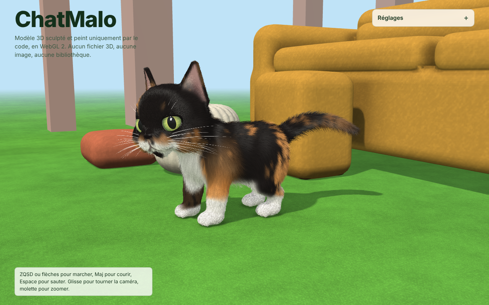

# Chaton tricolore 3D
https://alexmoriquand.github.io/CAT_WEB_GAME/

Un chaton tricolore en 3D, avec sa fourrure, qu'on peut faire tourner dans le navigateur. Il est **sculpté et peint uniquement par le code** : pas de fichier 3D, pas d'image, pas de bibliothèque. Juste du JavaScript et du WebGL 2.



## Fonctionnalités

- **Forme modélisée en mathématiques** : le corps est une surface implicite (SDF) faite d'ellipsoïdes et de cônes fondus entre eux, puis transformée en maillage d'environ 100 000 triangles.
- **Fourrure en 3D** : technique des *shells*, où le même maillage est redessiné en 32 couches (ou plus) poussées le long des poils. Le poil est long sur le dos, ras sur le visage et les pattes, et la largeur des brins s'adapte au zoom.
- **Robe peinte sommet par sommet** : écaille de tortue et blanc, avec un masque noir sur les yeux, une joue rousse, une barbiche noire au menton, le poitrail et les chaussettes blancs.
- **Yeux détaillés** : iris vert doré fibré, pupille, reflets sur la cornée et paupières qui clignent.
- **Plateformes** : 20 piliers disposés en cercle autour du départ, de plus en plus hauts (jusqu'à 110), pour grimper librement.
- **Canapé** : un canapé moutarde sculpté lui aussi par le code, avec un coussin au sol, un pouf tricoté et un repose-pieds qui servent de marches. Le chaton peut monter sur l'assise, les accoudoirs, les coussins et jusqu'en haut du dossier.
- **Déplacements** : le chaton marche, court et saute sur une grande pelouse, et la caméra le suit.
- **Allures de chat** : au pas, il pose une patte après l'autre, la queue dressée ; à la course, il galope, les arrière poussent ensemble puis les avant se reçoivent. Chaque patte plie au genou pour se lever.
- **Saut félin** : il se ramasse avant de bondir, tend les arrière à la montée, tend les avant vers le sol à la descente et amortit la réception.
- **Petits détails** : il se penche dans les virages, donne un coup de queue au repos, respire, cligne des yeux et suit le curseur du regard.
- **Éclairage** : ombres portées, occlusion ambiante, reflets le long des poils et duvet à contre-jour.
- **Réglages** : nombre de couches de poils, longueur du poil, pelage visible ou non, animation, rotation automatique.
- **Qualité adaptative** : le nombre de couches baisse automatiquement si l'affichage devient saccadé.

## Lancer le projet

Le projet utilise des modules JavaScript. Le navigateur refuse de les charger si on ouvre `index.html` en double-cliquant dessus (adresse en `file://`) : il faut passer par un petit serveur local.

Dans le dossier du projet, au choix :

```bash
npm start                      # avec Node.js
python -m http.server 8000     # avec Python, puis ouvrir http://localhost:8000
```

Dans VS Code, tu peux aussi faire un clic droit sur `index.html` puis *Open with Live Server*.

Il faut un navigateur qui gère WebGL 2 : Chrome, Edge, Firefox ou Safari récent.

## Commandes

| Action | Souris / tactile | Clavier |
| --- | --- | --- |
| Marcher | boutons à l'écran (tactile) | `ZQSD` ou flèches |
| Courir | bouton *Courir* (tactile) | maintenir `Maj` |
| Sauter | bouton *Saut* (tactile) | `Espace` |
| Tourner la caméra | glisser | |
| Zoomer | molette ou pincement | `+` / `-` |
| Recentrer | double-clic | bouton *Recentrer la vue* |

## Structure

```
index.html              page et panneau de réglages
styles/main.css         mise en page
src/
  main.js               WebGL, interface, caméra, déplacements et saut, boucle d'affichage
  utils/math.js         vecteurs, matrices, bruit
  kitten/shape.js       forme du chaton (surface implicite)
  kitten/coat.js        couleurs, rayures, longueur et direction des poils
  kitten/mesh.js        maillage par « surface nets »
  kitten/details.js     yeux, moustaches, texture des brins, ombre au sol
  kitten/gait.js        allures : pas, galop, saut, tenue de la queue
  world/course.js       position, taille et hauteur des 20 plateformes
  world/sofa.js         canapé, pouf, coussin, repose-pieds et leurs zones de collision
  world/sdfmesh.js      transforme une forme implicite en maillage (utilisé pour le canapé)
  render/shaders.js     shaders GLSL
```

## Comment ça marche

1. **La forme.** `sdf(x, y, z)` renvoie la distance d'un point à la peau du chaton : négative à l'intérieur, positive à l'extérieur. Chaque partie (crâne, joues, oreilles, pattes, queue…) est une forme simple, et `smin` les fond entre elles en douceur.
2. **Le maillage.** On évalue cette fonction sur une grille de 0,18 unité, seulement près de la surface pour aller plus vite. On place un sommet dans chaque cellule traversée par la surface, puis on recale chaque sommet exactement sur la peau.
3. **La peinture.** Pour chaque sommet, `shadeVertex` calcule la couleur (taches obtenues avec du bruit), la longueur et la direction du poil, et l'occlusion ambiante.
4. **La fourrure.** Le maillage est dessiné une fois en instanciation pour chaque couche. Chaque couche est poussée un peu plus loin le long du poil, et le shader ne garde que les pixels qui tombent sur un brin, d'après une texture 3D de points tirés au hasard.
5. **Le rendu.** Il se fait en deux passes : une carte d'ombres vue depuis la lumière, puis l'image (sol, peau, yeux, couches de poils, moustaches).

6. **Les déplacements.** Le chaton a une position, un cap et une hauteur. À chaque image, on applique la marche, la gravité et la collision avec le bloc. Il est dessiné dans son propre repère : on y ramène la caméra et la lumière.

Le modèle se construit au chargement de la page, ce qui prend une à deux secondes.

## Licence

[MIT](LICENSE)


## Améliorations anatomiques

Cette variante enrichit le volume procédural du chat avec des reliefs bilatéraux
fondus dans la silhouette : pectoraux, masses scapulaires, trapèzes, grand dorsal,
fessiers, ischio-jambiers, quadriceps et gastrocnémien. L'animation accentue
également la flexion lombaire au galop et maintient une queue relevée pendant
la course.


## Ajustements de la démarche féline

- Le balancement proximal des quatre membres est plus lisible : la cuisse entière suit davantage la hanche et le bras entier suit l'épaule, tandis que le genou/coude ajoute une flexion distincte pendant la phase aérienne.
- La tête accompagne la marche par de très petits ajustements de tangage deux fois par foulée, et de roulis/lacet une fois par foulée. Le regard reste globalement stabilisé vers l'avant.
- Ces mouvements sont volontairement subtils : les mesures publiées sur des chats marchant à plat rapportent environ 1,5 cm de déplacement vertical crête-à-crête et environ 3° de tangage crête-à-crête de la tête, avec une orientation générale légèrement nez vers le bas.
